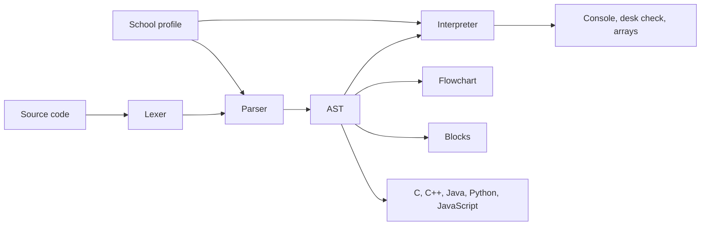

<div align="center">

# Codoritmo

**Learn to program with pseudocode, in your browser. PSeInt-compatible, free and open source.**

[](LICENSE)
[](https://nextjs.org/)
[](https://www.typescriptlang.org/)
[](CONTRIBUTING.md)

[Open Codoritmo](https://www.codoritmo.com/en) · [Examples](https://www.codoritmo.com/en/examples) · [Report a bug](../../issues) · [Español](README.md)

</div>

---

Codoritmo is a place to write, run and understand algorithms in **Spanish pseudocode**, right in the browser with nothing to install. It uses the same syntax as **PSeInt** and ships with its **463 school profiles**, so you can follow your course exactly as your teacher teaches it, on a school computer, a Chromebook or a phone.

It's built for beginners: every program can be watched step by step, in the code, the flowchart and the console at the same time.

## What you can do

- **Write PSeInt-compatible pseudocode**: `Algoritmo`, `Leer`, `Escribir`, `Si`, `Segun`, `Mientras`, `Repetir`, `Para`, arrays, functions and subprocesses, with autocomplete and hover help.
- **Watch your program run**: step by step, with pause, step forward and back. The current line lights up in the code and a light travels the **flowchart** block by block.
- **Automatic flowcharts** with standard symbols, exportable as PNG and SVG.
- **Block-based programming**, Scratch style, kept in sync with the code.
- **Automatic desk check (trace table)**: the value of every variable at every step.
- **Array visualiser** to watch sorting and searching, and **complexity analysis** (O(n), O(n²)…) measured by running the program.
- **Export to C, C++, Java, Python and JavaScript** to take the next step.
- **School profiles**: all 463 PSeInt profiles (each school's or university's rules), plus per-document tweaks.
- **Example library** by topic, from "Hello World" to sorting algorithms, with explanations and challenges.
- **Language reference** written for beginners, with verified examples.
- **Spanish and English**, and your files are saved in your browser: no account needed.

## How it relates to PSeInt

Codoritmo is inspired by [PSeInt](http://pseint.sourceforge.net/), the tool created by Pablo Novara that has taught millions of Spanish-speaking students to program. It is an **independent project**: not affiliated with PSeInt and not a replacement for it. It stays compatible with PSeInt's syntax and profiles so what you learn in class carries over, and adds tools for understanding what happens inside each algorithm.

For the official desktop application, visit [pseint.sourceforge.net](http://pseint.sourceforge.net/).

## Getting started

Requirements: Node.js 18 or later and npm (or yarn, pnpm, bun).

```bash
git clone https://github.com/kervin5/codoritmo.git
cd codoritmo
npm install
cp .env.example .env.local   # optional, see "Configuration"
npm run dev
```

Open [http://localhost:3000](http://localhost:3000).

| Command | What it does |
|---|---|
| `npm run dev` | Development server |
| `npm run build` and `npm start` | Build and serve for production |
| `npm test` | All tests (Jest) |
| `npm run lint` | ESLint |

## Configuration

No domain is written into the code. Copy `.env.example` to `.env.local`:

```env
# Public address of the site: canonical links, hreflang, sitemap, robots.txt and structured data.
# On Vercel the production domain is used automatically when this is unset.
NEXT_PUBLIC_SITE_URL=https://www.your-domain.com

# Repository linked from the app (defaults to this repository). Useful for forks.
# NEXT_PUBLIC_REPOSITORY_URL=https://github.com/your-user/codoritmo
```

## How it's built

```
codoritmo/
├── app/                      # Next.js routes (the app, static pages, sitemaps)
├── src/
│   ├── engine/               # Lexer, parser, interpreter, profiles, C/C++/Java/Python/JS generators
│   ├── diagram/              # Flowchart model, layout and drawing
│   ├── components/workspace/ # The editor: code, blocks, diagram, console, panels
│   ├── components/site/      # Public pages: profiles, reference, concepts, features
│   ├── i18n/                 # Spanish and English copy
│   └── seo/                  # Sections, sitemaps and structured data
└── scripts/                  # Utilities (e.g. importing the PSeInt profiles)
```



Built with [Next.js 16](https://nextjs.org/), [TypeScript](https://www.typescriptlang.org/), [Monaco Editor](https://microsoft.github.io/monaco-editor/), [Blockly](https://developers.google.com/blockly), [React Flow](https://reactflow.dev/) with [ELK.js](https://eclipse.dev/elk/), [Tailwind CSS 4](https://tailwindcss.com/), [Motion](https://motion.dev/) and [Jest](https://jestjs.io/).

## Contributing

Every contribution is welcome, from anyone: a student fixing a typo with help from an AI matters as much as someone with years of experience.

1. Fork and create a branch (`git checkout -b improve/whatever`).
2. Make your change, with tests where it applies, and check that `npm test` and `npm run lint` pass.
3. Open a pull request explaining what changes and why.

Good first ideas: new examples, translations, accessibility improvements, reports of differences from PSeInt. Details in [CONTRIBUTING.md](CONTRIBUTING.md).

## License

Codoritmo is free software under the **GNU General Public License, version 2 or later** ([GPL-2.0-or-later](LICENSE)). You may use, study, modify and share it, commercially too, as long as the versions you distribute stay free under the same license.

The school profiles in `src/engine/school-profiles.ts` come from PSeInt (`bin/perfiles`), distributed under GPL v2, and keep the credits of the people who sent them.

## Thanks

To **Pablo Novara** and the [PSeInt](http://pseint.sourceforge.net/) community, without whose work this project wouldn't exist; to the teachers who shared their profiles; and to the maintainers of the open-source tools it's built on.

<div align="center">

[Open Codoritmo](https://www.codoritmo.com/en) · [Star the repo](../../stargazers) · [Report a bug](../../issues)

</div>
