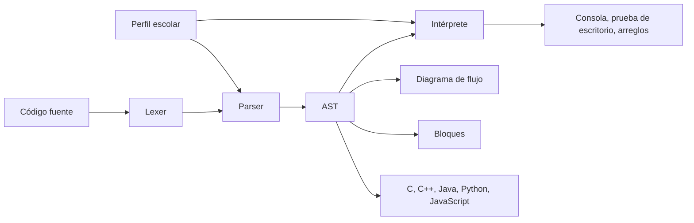

<div align="center">

# Codoritmo

**Aprende a programar con pseudocódigo, en el navegador. Compatible con PSeInt, gratis y de código abierto.**

[](LICENSE)
[](https://nextjs.org/)
[](https://www.typescriptlang.org/)
[](CONTRIBUTING.md)

[Abrir Codoritmo](https://www.codoritmo.com) · [Ejemplos](https://www.codoritmo.com/es/ejemplos) · [Reportar un error](../../issues) · [English](README.en.md)

</div>

---

Codoritmo es un entorno para escribir, ejecutar y entender algoritmos en **pseudocódigo en español**, directamente en el navegador y sin instalar nada. Usa la misma sintaxis que **PSeInt** y trae sus **463 perfiles escolares**, así que puedes seguir tu curso tal como lo enseña tu profesor, en la computadora del colegio, en una Chromebook o en el teléfono.

Está pensado para quien está empezando: cada programa se puede ver correr paso a paso, en el código, en el diagrama de flujo y en la consola a la vez.

## Qué puedes hacer

- **Escribir pseudocódigo compatible con PSeInt**: `Algoritmo`, `Leer`, `Escribir`, `Si`, `Segun`, `Mientras`, `Repetir`, `Para`, arreglos, funciones y subprocesos, con autocompletado y ayuda al pasar el ratón.
- **Ver tu programa correr**: ejecución paso a paso, con pausa, avance y retroceso. La línea actual se ilumina en el código y una luz recorre el **diagrama de flujo** de bloque en bloque.
- **Diagramas de flujo automáticos** con los símbolos estándar, exportables a PNG y SVG.
- **Programar con bloques**, al estilo de Scratch, sincronizados con el código.
- **Prueba de escritorio** automática: una tabla con el valor de cada variable en cada paso.
- **Visualizador de arreglos** para ver cómo se ordenan y recorren, y **análisis de complejidad** (O(n), O(n²)…) medido al ejecutar.
- **Exportar a C, C++, Java, Python y JavaScript** para dar el siguiente paso.
- **Perfiles escolares**: los 463 perfiles de PSeInt (reglas de cada colegio o universidad), más ajustes propios por documento.
- **Biblioteca de ejemplos** por tema, desde "Hola Mundo" hasta algoritmos de ordenamiento, con explicaciones y retos.
- **Referencia del lenguaje** explicada para principiantes, con ejemplos comprobados.
- **Español e inglés**, y tus archivos se guardan en tu navegador: no hace falta crear una cuenta.

## Relación con PSeInt

Codoritmo está inspirado en [PSeInt](http://pseint.sourceforge.net/), la herramienta creada por Pablo Novara que ha enseñado a programar a millones de estudiantes hispanohablantes. Es un **proyecto independiente**: no está afiliado a PSeInt ni lo reemplaza. Mantiene compatibilidad con su sintaxis y sus perfiles para que puedas usar lo que aprendes en clase, y agrega herramientas pensadas para entender lo que pasa dentro de cada algoritmo.

Para la aplicación oficial de escritorio, visita [pseint.sourceforge.net](http://pseint.sourceforge.net/).

## Empezar

Requisitos: Node.js 18 o superior y npm (o yarn, pnpm, bun).

```bash
git clone https://github.com/kervin5/codoritmo.git
cd codoritmo
npm install
cp .env.example .env.local   # opcional, ver "Configuración"
npm run dev
```

Abre [http://localhost:3000](http://localhost:3000).

| Comando | Qué hace |
|---|---|
| `npm run dev` | Servidor de desarrollo |
| `npm run build` y `npm start` | Compilar y servir en producción |
| `npm test` | Todas las pruebas (Jest) |
| `npm run lint` | ESLint |

## Configuración

Ningún dominio está escrito en el código. Copia `.env.example` a `.env.local`:

```env
# Dirección pública del sitio: enlaces canónicos, hreflang, sitemap, robots.txt y datos estructurados.
# En Vercel se usa el dominio de producción automáticamente si no la defines.
NEXT_PUBLIC_SITE_URL=https://www.tu-dominio.com

# Repositorio enlazado desde la app (por defecto, este repositorio). Útil para forks.
# NEXT_PUBLIC_REPOSITORY_URL=https://github.com/tu-usuario/codoritmo
```

## Cómo está hecho

```
codoritmo/
├── app/                      # Rutas de Next.js (app, páginas estáticas, sitemaps)
├── src/
│   ├── engine/               # Lexer, parser, intérprete, perfiles y generadores de C/C++/Java/Python/JS
│   ├── diagram/              # Modelo, distribución y dibujo de los diagramas de flujo
│   ├── components/workspace/ # El editor: código, bloques, diagrama, consola, paneles
│   ├── components/site/      # Páginas públicas: perfiles, referencia, conceptos, funciones
│   ├── i18n/                 # Textos en español e inglés
│   └── seo/                  # Secciones, sitemaps y datos estructurados
└── scripts/                  # Utilidades (por ejemplo, importar los perfiles de PSeInt)
```



Tecnologías: [Next.js 16](https://nextjs.org/), [TypeScript](https://www.typescriptlang.org/), [Monaco Editor](https://microsoft.github.io/monaco-editor/), [Blockly](https://developers.google.com/blockly), [React Flow](https://reactflow.dev/) con [ELK.js](https://eclipse.dev/elk/), [Tailwind CSS 4](https://tailwindcss.com/), [Motion](https://motion.dev/) y [Jest](https://jestjs.io/).

## Contribuir

Toda ayuda es bienvenida, venga de quien venga: un estudiante que arregla un error de ortografía con ayuda de una IA aporta tanto como alguien con años de experiencia.

1. Haz un fork y crea una rama (`git checkout -b mejora/lo-que-sea`).
2. Haz tus cambios con pruebas cuando aplique, y verifica que `npm test` y `npm run lint` pasen.
3. Abre un Pull Request explicando qué cambia y por qué.

Ideas para empezar: nuevos ejemplos, traducciones, mejoras de accesibilidad, reportes de diferencias con PSeInt. Detalles en [CONTRIBUTING.md](CONTRIBUTING.md).

## Licencia

Codoritmo es software libre bajo la **Licencia Pública General de GNU, versión 2 o posterior** ([GPL-2.0-or-later](LICENSE)). Puedes usarlo, estudiarlo, modificarlo y compartirlo, también con fines comerciales, siempre que las versiones que distribuyas sigan siendo libres bajo la misma licencia.

Los perfiles escolares de `src/engine/school-profiles.ts` provienen de PSeInt (`bin/perfiles`), distribuido bajo GPL v2, y conservan los créditos de quienes los enviaron.

## Agradecimientos

A **Pablo Novara** y a la comunidad de [PSeInt](http://pseint.sourceforge.net/), sin cuyo trabajo este proyecto no existiría; a los docentes que compartieron sus perfiles; y a quienes mantienen las herramientas de código abierto sobre las que está construido.

<div align="center">

[Abrir Codoritmo](https://www.codoritmo.com) · [Dale una estrella](../../stargazers) · [Reportar un error](../../issues)

</div>
